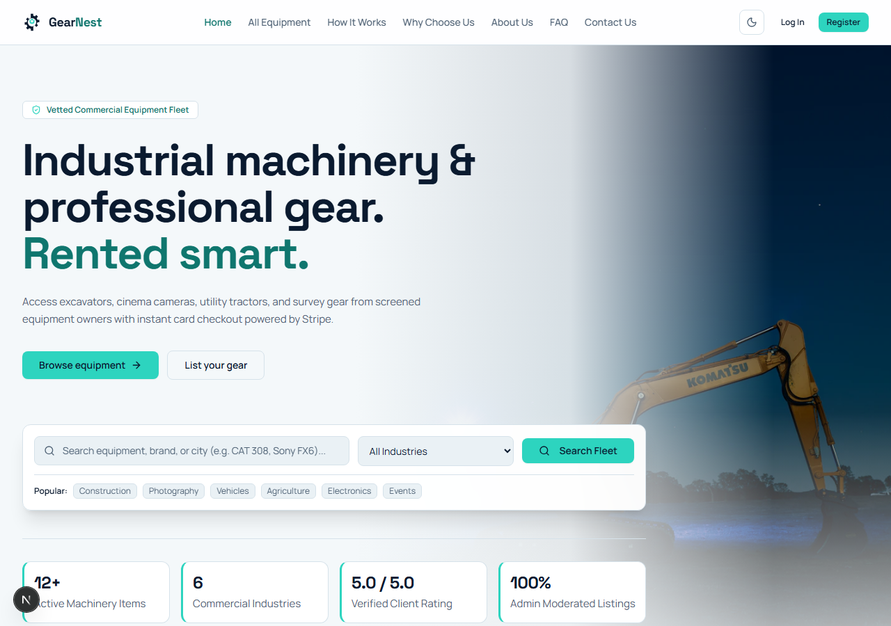
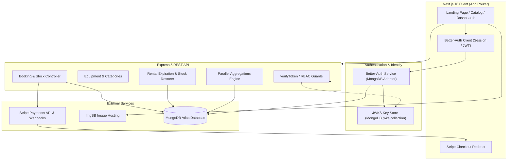

# GearNest — Modern Smart-Rental Marketplace for Heavy Machinery & Industrial Equipment

[](https://nextjs.org/)
[](https://react.dev/)
[](https://www.typescriptlang.org/)
[](https://tailwindcss.com/)
[](https://www.better-auth.com/)
[](https://stripe.com/)
[](https://www.framer.com/motion/)
[](https://vercel.com/)

**GearNest** is a full-stack, enterprise-grade heavy machinery and equipment rental marketplace connecting contractors, cinematography leads, and industrial operators with verified fleet owners. Engineered with photo-led design, atomic inventory locks, Stripe payment processing, and strict role-based access control (RBAC).

- **Production Client URL**: [https://gearnest-client.vercel.app](https://gearnest-client.vercel.app)
- **Production API URL**: [https://gearnest-server.vercel.app](https://gearnest-server.vercel.app)

---

## Platform Preview

<p align="center">
  
</p>

---

## Architectural Workflow



---

## Key Features by Workspace Role

### 1. Public Marketplace & Catalog Discovery
- **Hero & Category Grid**: Photo-led hero layout with high-contrast scrims, ambient blend, and a 6-category compact grid (`Construction`, `Photography`, `Vehicles`, `Agriculture`, `Electronics`, `Events`).
- **Dynamic Search & Multi-Filter**: Real-time regex-escaped search across name, brand, location, and description, paired with category, price range, rental unit (`Daily`, `Weekly`, `Monthly`), and in-stock filtering.
- **Equipment Detail Page**: Technical specifications, condition metrics, owner dispatch card, and login redirect preservation (`callbackUrl`).
- **Brand Theming**: 100% tokenized color palette supporting seamless light/dark modes with WCAG AAA compliant contrast ratios.

### 2. Customer / Renter Workspace
- **Live Wishlist / Favorites**: Interactive saved machinery with optimistic UI transitions backed by MongoDB compound indexes (`customerId + equipmentId`).
- **Dynamic Stripe Checkout**: Server-calculated rental durations and pricing units with automatic inventory validation before Stripe redirection.
- **Rental Progression**: Real-time contract status badges (`Active`, `Completed`, `Cancelled`) and transaction receipts.
- **Self-Service Cancellations**: Customers can instantly cancel pending, unpaid reservations to free reserved fleet allocations.

### 3. Equipment Owner / Partner Portal
- **Fleet Management**: Catalog table of listed machinery with administrative review status (`Approved`, `Pending`, `Rejected`).
- **Listing Submission Wizard**: Multi-field equipment creation with ImgBB direct image upload, specifications, and default pending moderation flow.
- **Rental Order Execution**: Process incoming customer bookings with atomic stock restoration upon transitioning orders to `Completed` or `Cancelled`.
- **Fleet Analytics**:
  - Stat KPI Cards: Gross Fleet Earnings, Listed Fleet Size, Active Deployments, Completed Orders.
  - 6-Month Monthly Earnings Velocity chart (`AreaChart`).
  - Fleet Moderation Distribution donut chart (`PieChart`).

### 4. Administrator Moderation Suite
- **Equipment Moderation**: Approve or reject pending partner listings with instant reflection across the public catalog.
- **Platform User Management**: Role management (`customer`, `owner`, `admin`) guarded against self-demotion and account self-deletion.
- **Master Platform Analytics**:
  - Global KPIs: Total Platform Users, Fleet Inventory, Pending Approvals, Active Deployments, Gross Stripe Volume.
  - 6-Month Revenue Trajectory chart (`AreaChart` with amber gradient).
  - Monthly Booking Volume trend (`BarChart`).
  - Fleet distribution breakdown across commercial categories.
- **Rental Audit Log**: Complete historical record of all bookings across all owners and renters.

---

## Demo Accounts & Role-Based Access

The platform features pre-configured accounts for evaluating all access levels:

| Role | Demo Email | Access Scope |
| :--- | :--- | :--- |
| **Customer** | `customer@gearnest.com` | Public catalog, favorites, Stripe checkout, rental tracking |
| **Fleet Owner** | `owner@gearnest.com` | Equipment listing, fleet orders, return dispatch, owner analytics |
| **Platform Administrator** | `admin@gearnest.com` | Listing moderation queue, user RBAC, platform-wide audit, master analytics |

> [!NOTE]
> Demo passwords are protected against unauthorized modification on shared environments. Evaluators can log in using the pre-configured credentials provided above or in the evaluation submission form.

---

## Tech Stack & Core Technologies

| Technology | Badge | Purpose |
| :--- | :--- | :--- |
| **Next.js 16** |  | App Router, Server Components, Turbopack |
| **React 19** |  | Modern UI library with action hooks |
| **TypeScript** |  | Strict type safety across client & schemas |
| **Tailwind CSS v4** |  | Tokenized theme variables & utilities |
| **Better-Auth** |  | MongoDB adapter, JWT plugin, session cookies |
| **Stripe** |  | Client redirect & hosted checkout |
| **Framer Motion** |  | Hardware-accelerated UI choreographies |
| **Recharts** |  | Visual analytics (AreaChart, BarChart, PieChart) |
| **Lucide React** |  | Crisp, lightweight SVG iconography |
| **Sonner** |  | Accessible toast notification system |

---

## Environment Variables Reference

Create a `.env.local` file in the `gearnest-client` directory:

```bash
# Better-Auth Secret & Configuration
BETTER_AUTH_SECRET="your_secure_random_auth_secret_minimum_32_characters"
BETTER_AUTH_URL="http://localhost:3000"
BETTER_AUTH_DB_URI="mongodb+srv://<user>:<password>@cluster.mongodb.net/gearnestdb"
DB_NAME="gearnestdb"

# Public Application URLs
NEXT_PUBLIC_APP_URL="http://localhost:3000"
NEXT_PUBLIC_API_URL="http://localhost:5000"

# Image Uploads (ImgBB Direct Client Upload)
NEXT_PUBLIC_IMGBB_API_KEY="your_imgbb_api_key"

# Stripe Public Key
NEXT_PUBLIC_STRIPE_PUBLISHABLE_KEY="pk_test_..."
STRIPE_SECRET_KEY="sk_test_..."

# Optional Google OAuth Credentials
GOOGLE_CLIENT_ID="your_google_oauth_client_id"
GOOGLE_CLIENT_SECRET="your_google_oauth_client_secret"
```

---

## Local Development Setup

1. **Clone the repository**:
   ```bash
   git clone https://github.com/Md-Rifat-Al-Faisal/gearnest-client.git
   cd gearnest-client
   ```

2. **Install dependencies**:
   ```bash
   npm install
   ```

3. **Configure environment variables**:
   ```bash
   cp .env.example .env.local
   # Update values in .env.local
   ```

4. **Start development server**:
   ```bash
   npm run dev
   ```
   Open [http://localhost:3000](http://localhost:3000) in your browser.

5. **Typecheck & Production Build**:
   ```bash
   npx tsc --noEmit
   npm run build
   ```
